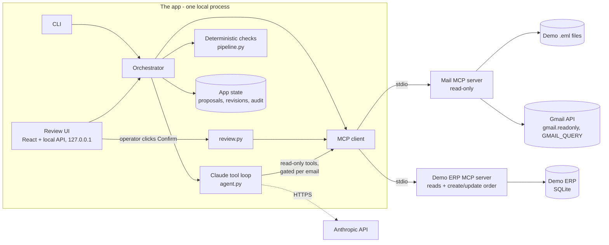
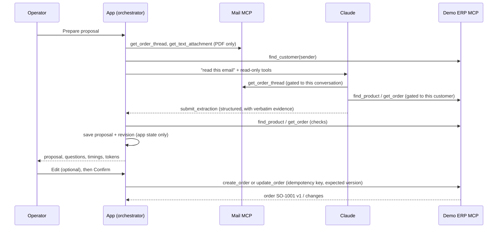

# Architecture

## In one picture



| Part | Responsibility | Code |
|---|---|---|
| **Mail MCP server** | Lists and reads order conversations; extracts the text of PDF attachments. No write tools. Source: demo files or Gmail, chosen by `INBOX_MODE`. | `mcp_servers/mail_server.py`, `services/inbox_sources.py`, `services/pdf_extract.py` |
| **Demo ERP MCP server** | The fictional order system: customers, ship-to addresses, catalog, customer item codes, orders. Read tools plus `create_order` / `update_order`, which validate everything again. | `mcp_servers/erp_server.py`, `services/erp.py` |
| **Model** | Claude via the Messages API with a manual tool loop. Reads one email through allow-listed read-only tools and returns a structured proposal. Decides nothing. | `agent.py` |
| **Deterministic checks** | Plain code that verifies the model's proposal against the source and the ERP's records. | `pipeline.py`, `services/quantities.py` |
| **App state** | The app's own SQLite: proposals, revisions, which emails were processed, audit trail. Not the ERP. | `db.py`, `services/drafts.py` |
| **Operator review** | Edit, reject, confirm. Confirm is the only path that calls the ERP write tools. | `web/server.py`, `frontend/`, `review.py` |

## The path of one email



Without an API key, the rule-based baseline replaces the "AI" steps; everything else is identical.

## Tools actually exposed

Output of `uv run inbox-to-order mcp-diagnose` on a fresh database (2026-11-05):

```text
Server 'mail' (inbox_to_order.mcp_servers.mail_server) over stdio, protocol 2026-07-28, reports itself as demo-mail
Server 'erp' (inbox_to_order.mcp_servers.erp_server) over stdio, protocol 2026-07-28, reports itself as demo-erp

Discovered tools (tools/list):
  erp   create_order         read_only=False available to: app only
  erp   find_customer        read_only=True  available to: model+app
  erp   find_product         read_only=True  available to: model+app
  erp   get_customer         read_only=True  available to: app only
  erp   get_order            read_only=True  available to: model+app
  mail  get_order_thread     read_only=True  available to: model+app
  mail  get_text_attachment  read_only=True  available to: model+app
  mail  list_order_threads   read_only=True  available to: app only
  erp   list_orders          read_only=True  available to: app only
  erp   list_products        read_only=True  available to: app only
  erp   update_order         read_only=False available to: app only
```

Every tool returns a pydantic model, so the server publishes an `outputSchema` and returns
`structuredContent`. Errors are MCP tool errors with a stable code (`VERSION_CONFLICT: ...`,
`UNIT_MISMATCH: ...`, `GMAIL_NOT_CONFIGURED: ...`) that the client turns into `ToolCallError(tool, code, message)`.
The write tools are annotated `readOnlyHint=false, destructiveHint=false, idempotentHint=true`.

## Three layers of control

1. **What the model can reach.** It is offered five read-only tools (`MODEL_ALLOWED_TOOLS`) plus a local
   `submit_extraction`. Before any call reaches MCP, `gate_tool_call` checks that it reads only the selected
   conversation, attachments of the selected message, the actual sender, and the customer resolved from the
   sender. Refusals are logged as `refused_by_gate`. The model is never offered the ERP write tools, the mailbox
   listing or the order listing. The Anthropic key is not passed to the MCP server processes.
2. **What the app accepts from the model.** Every value must come with an excerpt that occurs verbatim in the
   cited source; otherwise it is dropped and a question is raised. Customer comes from the sender address only.
   Items are resolved through the ERP's catalog and the customer's own item codes; two candidates are never
   resolved automatically. Quantities are parsed in code; a different unit is a question, never a conversion.
   A change must identify exactly one existing line and agree with any stated previous value
   ("eight cases, not six").
3. **What reaches the ERP.** Only the operator's click on **Confirm & write to Demo ERP** calls `create_order` or
   `update_order` (`review.confirm_and_write`), and only for a proposal with no open question, at the version the
   operator saw. The ERP validates again (customer, address ownership, SKU, selling unit, quantity range,
   duplicates, unique PO per customer), uses an idempotency key (`proposal-<id>-v<version>`: a retry never creates a
   second order) and an optimistic version check (`VERSION_CONFLICT` if the order changed meanwhile).

This follows common guidance for LLM tools that can act: limit the tools and their scope, keep business rules
in code, and put a person in front of consequential writes (OWASP Top 10 for LLM Applications 2025, *LLM06:
Excessive Agency*; the MCP specification's guidance that a human should be able to deny tool invocations).

## New order or change?

The model (or the baseline) proposes an *intent*; the code decides what it applies to:

- **New order**: if a proposal for the same customer and PO already exists in the app, or the PO already exists
  in the Demo ERP, nothing is created; the operator sees why.
- **Change**: the target is the proposal for that customer + PO in the app. If there is none but the ERP has the
  order (fixture H), the app copies the ERP order as proposal v1 (actor `demo-erp`) and applies the change as v2,
  so the operator reviews a before/after and the confirm becomes `update_order`.
- A change to a proposal already written to the ERP reopens it; confirming again updates the ERP order.
- If the PO in the email disagrees with the conversation, or the email names several POs, nothing is applied.

## Statuses

| Proposal status | Shown as | Meaning |
|---|---|---|
| `needs_review` | Needs review | At least one open question; Confirm is disabled until the operator edits |
| `ready` | Ready to confirm | Every value verified; waiting for the operator |
| `confirmed` | Written to Demo ERP | The current version was written; the ERP order id and version are stored |
| `rejected` | Rejected | Closed by the operator; nothing written |

Line and ship-to statuses: *Matched*, *Needs review*, *Missing*, *Not supported*.

## Storage

Two SQLite files, both git-ignored under `data/`:

- **App state** (`INBOX_TO_ORDER_DB`): `order_drafts` (proposals, unique per customer + PO, with the ERP order id
  and version once written), `draft_lines` (with evidence), `draft_revisions` (one row per version, with actor
  `assistant`, `operator` or `demo-erp` and the before/after changes), `processed_sources` (idempotency per source
  message and content hash), `audit_events` (redacted to an allowlist of keys; no email bodies).
- **Demo ERP** (`DEMO_ERP_DB`): `customers`, `customer_addresses`, `products`, `customer_item_codes`, `orders`,
  `order_lines`, `order_history`, `idempotency_keys`. Seeded from `fixtures/` (including one existing order,
  `SO-0950` / `PO-48190`). Only the Demo ERP MCP server reads and writes it at run time.

Keeping them apart mirrors reality: the ERP is someone else's system; the app keeps only its own working state.

## Why MCP here — and what it does not do

Both ends of this workflow vary from company to company: where orders arrive (Gmail, Microsoft 365, IMAP, a
portal) and where they go (an ERP, a CRM, a spreadsheet). MCP gives the app one standard way to discover and
call tools on each side (`tools/list`, `tools/call`, JSON-RPC over stdio here). Swapping Gmail for another mailbox
or the Demo ERP for a real system means writing another server with the same tools; the orchestrator, the checks
and the review UI stay the same.

What MCP does **not** do: it does not define the tools' meaning. `create_order` and its fields are this project's
contract. Connecting a real ERP still requires mapping its customers, items, units and rules to that contract —
MCP isolates that work in one server; it does not remove it. The model API and the UI are not behind MCP.

## Timing (measured)

Measured on 2026-11-05 on the development machine (Windows 11, 16 logical CPUs, Python 3.12), demo emails,
rule-based baseline — so **no model time is included**:

| What | Result |
|---|---|
| Start both MCP servers (two Python processes) + initialize + `tools/list`, 5 runs | median 3.78 s (min 3.66, max 3.84) |
| One `tools/call` (`find_product`) on a running session, 20 runs | median 2.9 ms |
| Process email A (new order, PDF + logo) on a running session | 202 ms (one run; includes first PDF read) |
| Process emails B, C, D, H on a running session | 33 / 46 / 62 / 39 ms (one run each) |
| Confirm → `create_order` in the Demo ERP | 37 ms (one run) |

The UI keeps both servers running (`McpSession`), so the ~3.8 s start-up is paid once, not per click; the UI
shows it in the header. With Claude, the model calls dominate; the UI shows the measured time and the tokens of
each run.

With Claude Haiku 5.5 (live, 2026-11-05, effort `medium`): 4.1–10.6 s per email, 2–3 API calls each, 50.0 s and
an estimated $0.0127 for all 8 demo emails (82,252 input + 8,960 output tokens). The model call is now the
largest step by two orders of magnitude; the MCP calls around it add tens of milliseconds. Per-email figures are
in [TEST_RESULTS.md](TEST_RESULTS.md).

**Reading several conversations at once.** With Claude, each email takes seconds, and almost all of it is the
model. "Read all new" therefore reads up to 4 conversations at the same time, longest conversations first;
within a conversation the emails stay in order, because each builds on the proposal left by the one before.
The MCP servers run their tools in worker threads, so the calls of different runs overlap. Measured on a Gmail
test account with 10 emails in 7 conversations, Claude Haiku 5.5, effort `medium`, through the UI: 53.5 s one
conversation at a time (2026-11-06), 19.4 s with 4 at a time (2026-11-07), with the same decisions.

## Model integration details

- Anthropic Python SDK 2.4.0, `client.beta.messages.create`, manual tool loop, at most 8 rounds.
- Default model `claude-haiku-5-5` (the lowest-cost model); any Claude model id can be set with `ANTHROPIC_MODEL`
  or chosen in the UI's Settings menu. `effort` is configurable (`ANTHROPIC_EFFORT`, default `medium`). Server-side fallback
  is requested only for models that support it (Sonnet 5.5, Opus 5.5).
- Handled outcomes: `refusal`, `max_tokens`, no submission, invalid submission (one correction round, then
  failure), API and network errors. A failed extraction saves nothing and later messages of the same
  conversation wait.
- Token usage is read from each API response, summed per email, and priced with the list prices in `config.py`
  (an estimate; your Anthropic invoice is the reference).

## Versions

MCP Python SDK 2.3.0 (`MCPServer`, `Client` with `StdioServerParameters`; protocol `2026-07-28` negotiated in this
repository's runs), Anthropic Python SDK 2.4.0, Python 3.12, FastAPI, React 18, pypdf, SQLite. Exact versions are pinned in
`uv.lock`.
